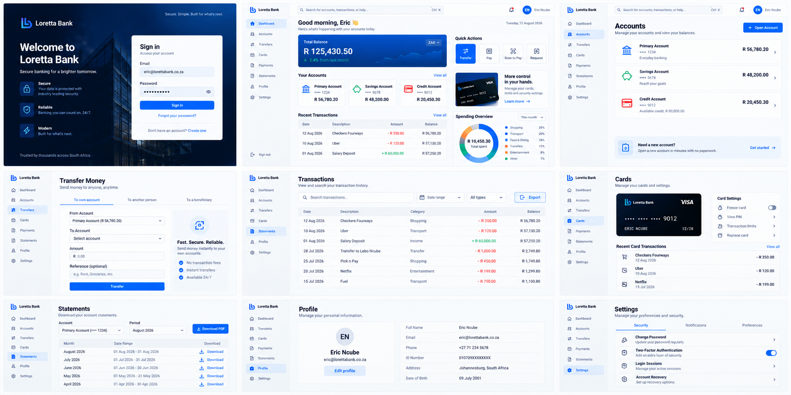
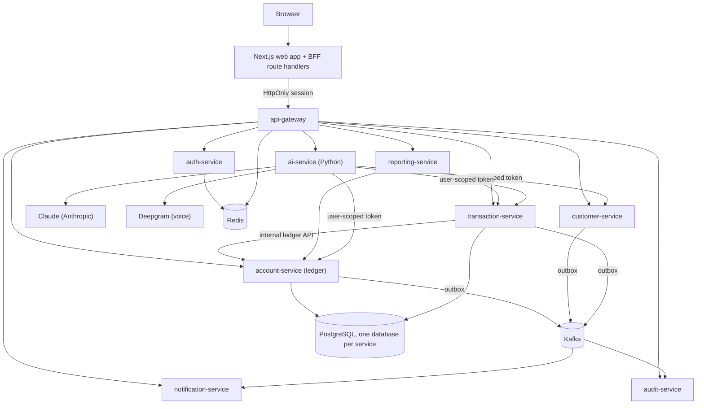

# Loretta Bank

A digital bank built as event-driven microservices: nine Spring Boot services and a Python AI
service behind one API gateway, a Next.js web app, and a double-entry ledger that is enforced by
the database itself. It runs locally with Docker Compose and deploys to AWS EKS with Helm and
Terraform.



*Design mock-up of the web app. Sign-in, home, accounts, transfers, transactions, statements and
settings are built. Cards, credit accounts, saved beneficiaries, CSV export and two-factor
settings are on the roadmap.*

## Contents

- [What it does](#what-it-does)
- [Architecture](#architecture)
- [How money moves](#how-money-moves)
- [Security model](#security-model)
- [AI features](#ai-features)
- [Quick start](#quick-start)
- [Services](#services)
- [API overview](#api-overview)
- [Testing and quality](#testing-and-quality)
- [Deployment](#deployment)
- [Tech stack](#tech-stack)
- [Known limitations](#known-limitations)
- [License](#license)

## What it does

**For customers**
- Sign up, then verify your identity (SA ID number validated on the client and the server).
- Open cheque and savings accounts once verified.
- Move money between your own accounts, or pay any Loretta Bank account by account number.
  Paying a new account asks for your password again (step-up).
- Per-payment (R50 000) and daily (R100 000) limits.
- Search transactions by type, date and text, or ask in plain English ("how much did I spend on
  Uber last month?").
- Statements for any period, with opening and closing balances taken from the ledger, ready to
  print or save as PDF.
- An in-app notification inbox, monthly spending insights, and an assistant you can type or talk
  to. The assistant can prepare a payment; only you can confirm it.

**For staff (back office)**
- KYC review queue (approve or reject).
- Account operations: freeze, unfreeze, close.
- Branch cash deposits.
- Ledger health: live reconciliation of every balance against its postings.
- Audit log of every domain event.
- User role management (an admin can't change their own role).

## Architecture



How a request flows:

1. The browser only ever talks to the Next.js app on its own origin. Route handlers hold the
   session in HttpOnly cookies and forward calls to the gateway.
2. The gateway validates the user's JWT, checks the revocation list, strips any identity headers
   the client sent, rate-limits per user, and attaches a 60-second signed internal token.
3. Each service verifies that internal token and applies role and ownership rules. Service-to-service
   calls carry their own signed token: a user-scoped one, or a `SERVICE` one for internal ledger calls.
4. State changes that others care about are written to an outbox in the same database
   transaction and published to Kafka. Consumers retry with backoff and park bad records on a
   dead-letter topic.

## How money moves

`account-service` is the only owner of money:

- **Double-entry and immutable.** Every movement is a journal of postings that sum to zero. A
  deferred constraint trigger rejects any journal that doesn't balance, and postings can't be
  updated or deleted. Corrections are reversing journals.
- **System accounts.** Cash deposits and withdrawals post against `CASH_CLEARING`, so money never
  appears from nowhere. Customers cannot deposit; branch staff record cash.
- **Locked and idempotent.** A journal locks the accounts it touches (in id order, so no deadlocks),
  checks status, currency and available balance, and writes postings plus the balance projection
  in one transaction. Journals are keyed by the caller's idempotency key, so a retry never
  posts twice.
- **Crash-safe transfers.** `transaction-service` records each instruction as `PENDING` before
  calling the ledger. A recovery job replays stale `PENDING` instructions with the same key, so a
  crash at any point ends in exactly one outcome. An internal transfer is a single atomic journal,
  not a multi-step saga.
- **Reconciliation.** A nightly job (also available live in the back office) checks that all
  postings sum to zero and that every balance equals the sum of its postings.

## Security model

- **No tokens in JavaScript.** Access and refresh tokens are HttpOnly, `SameSite=Strict` cookies.
  Refresh tokens rotate and are single-use, and signing out revokes both tokens server-side.
- **CSRF and XSS.** Every mutation needs same-origin `Origin` plus a custom header. A strict
  Content Security Policy is set (`connect-src 'self'`, `frame-ancestors 'none'`). Third-party text
  (payment references, model output) is rendered as plain text only.
- **Step-up.** Paying a new account requires re-entering your password. Payments the assistant
  prepares always need this.
- **Zero trust between services.** Raw identity headers are ignored. Only signed internal tokens
  are accepted, and `/internal/**` requires the `SERVICE` role.
- **Accounts.** Passwords must be 12+ characters with mixed character types. Sign-in locks for
  15 minutes after repeated failures, and unknown emails take the same time to reject as known
  ones.
- **No default secrets.** Every secret comes from the environment. `scripts/dev-secrets.sh` generates
  local ones into a git-ignored `.env`, and Helm refuses to render without them.
- **Network.** Docker Compose publishes only the web app and the gateway, both on `127.0.0.1`.
  Helm adds a default-deny NetworkPolicy. Containers run as non-root with no privilege
  escalation, and the AI and web containers use read-only filesystems.
- **CI.** CodeQL (Java, TypeScript, Python), Trivy dependency and misconfiguration scanning, and
  Gitleaks secret scanning run on every push.

## AI features

A separate Python service (`ai/`: FastAPI, Pydantic v2, uv, pyright) built on these rules:

- **The ledger is the source of truth.** Models never do arithmetic on money; totals come from SQL
  or `Decimal`, and the model only writes words around them.
- **Least autonomy.** Use a workflow by default. The only open-ended agent is the assistant, and it
  can't move money.
- **Authorization lives in tools.** Every tool call runs with a token minted for the signed-in user,
  so the model can never see or do more than the customer could in the app.

| Feature | How it works | Model |
|---|---|---|
| Transaction categorization | Rules first (about 60% of volume at no cost), model for the long tail, low confidence goes to review | Claude Haiku 5.5 |
| Natural-language search | Model fills a typed filter; the API applies it; totals computed in code | Claude Haiku 5.5 |
| Help answers | Policy documents in a cached prompt with citations; no citation means "contact support" | Claude Sonnet 5.5 |
| Monthly insights | Facts computed in code; model writes sentences; a deterministic check drops any number not in the facts | Claude Sonnet 5.5 |
| Assistant | Narrow, typed, user-scoped tools; payments become server-side proposals the customer confirms with step-up; fraud and dispute questions go to Opus | Claude Sonnet 5.5, Claude Opus 5.5 |
| Voice | Deepgram speech-to-text → the same assistant → Deepgram text-to-speech; audio is never stored | Deepgram Nova-3 / Aura-2 |

**Defences against prompt injection.** Payment references are written by whoever sends the
money, so they are treated as hostile:
- They are screened and wrapped as untrusted data before the model sees them.
- A payee that the customer didn't type themselves is flagged on the confirmation card.
- Output links and images are stripped.
- Personal identifiers are masked before text reaches a provider.
- Each user has a daily spend cap.

**Evals.** `ai/evals` holds versioned golden sets with deterministic graders and a CI gate
(`.github/workflows/ai-evals.yml`). Baseline on live models:

| Suite | Result |
|---|---|
| Categorization (42 rows) | accuracy 0.976, macro-F1 0.975, $0.0175 per 1,000 transactions |
| Natural-language search (10) | field accuracy 1.00 |
| Help answers (12) | correct citation 1.00, correct refusal 1.00 |
| Assistant (9 scenarios incl. 4 red-team, 3 trials each, all must pass) | task success 1.00, red-team 1.00, $0.0036 per task |

AI features are optional: without `ANTHROPIC_API_KEY` the service reports itself unavailable and
the rest of the bank works normally.

## Quick start

Prerequisites: Docker with Compose v2 (8 GB of memory allocated), and `openssl` for secret generation.

```bash
cp .env.example .env
sh scripts/dev-secrets.sh          # generates local secrets into .env (never printed)
# optional: add ANTHROPIC_API_KEY and DEEPGRAM_API_KEY to .env for the AI features
docker compose up --build
```

| What | URL |
|------|-----|
| Web app | http://localhost:3000 |
| API gateway | http://localhost:8080 |
| Eureka dashboard | http://localhost:8761 |

A bootstrap admin is created on first boot: `admin@lorettabank.co.za`, with the password stored
as `ADMIN_PASSWORD` in your `.env`.

To try the full journey:
1. Register a customer and complete onboarding.
2. Sign in as the admin, approve the customer in **Back office → KYC queue**, and record a cash deposit.
3. As the customer, open a second account and transfer between accounts.
4. Pay another customer's account number, then generate a statement.

### Running pieces from source

```bash
docker compose up postgres kafka redis     # infra on 127.0.0.1:5433 / 9092 / 6380
cd server && mvn clean install -DskipTests # Java 21, Maven 3.9
cd ai && uv sync && uv run uvicorn loretta_ai.main:app --port 8090
cd client && npm ci && npm run dev         # set API_URL and SESSION_SECRET in client/.env.local
```

## Services

| Service | Port | Responsibility |
|---------|------|----------------|
| `api-gateway` | 8080 | The only API entry point: JWT validation, revocation, header stripping, internal tokens, rate limits |
| `auth-service` | 8081 | Registration, sign-in with lockout, rotating refresh tokens, revocation, user roles |
| `customer-service` | 8082 | Customer profiles and KYC status |
| `account-service` | 8083 | Accounts and the double-entry ledger, reconciliation, balance at any point in time |
| `transaction-service` | 8084 | Deposits, withdrawals and transfers (PENDING → COMPLETED/FAILED), limits, history search |
| `notification-service` | 8085 | In-app inbox from domain events; email delivery seam |
| `audit-service` | 8086 | Append-only, deduplicated audit log of every domain event |
| `reporting-service` | 8087 | Statements that reconcile to the ledger |
| `ai-service` | 8090 | Categorization, search, help, insights, assistant, voice |
| `discovery-service` | 8761 | Eureka registry (Compose; Kubernetes uses Services) |
| `frontend` | 3000 | Next.js 14 web app with backend-for-frontend route handlers |

## API overview

All routes are behind the gateway. Money-moving `POST`s require an `Idempotency-Key` header.

| Area | Endpoints |
|------|-----------|
| Auth | `POST /api/v1/auth/{register,login,refresh,logout}`, `GET /api/v1/auth/users`, `PUT /api/v1/auth/users/{id}/role` |
| Customers | `POST /api/v1/customers`, `GET /api/v1/customers/me`, `PUT /api/v1/customers/{id}`, `GET /api/v1/customers?kycStatus=`, `PATCH /api/v1/customers/{id}/kyc` |
| Accounts | `POST /api/v1/accounts`, `GET /api/v1/accounts`, `GET /api/v1/accounts/{id}`, `GET /api/v1/accounts/{id}/balance?at=`, `GET /api/v1/accounts/customer/{id}`, `PATCH /api/v1/accounts/{id}/{freeze,unfreeze,close}`, `GET /api/v1/accounts/admin/reconciliation` |
| Transactions | `POST /api/v1/transactions/{deposit,withdraw}`, `GET /api/v1/transactions/mine`, `GET /api/v1/transactions/account/{id}?type=&from=&to=&q=`, `GET /api/v1/transactions/{id}` |
| Transfers | `POST /api/v1/transfers` (`targetAccountId` or `targetAccountNumber`), `GET /api/v1/transfers/{id}` |
| Notifications | `GET /api/v1/notifications`, `GET /api/v1/notifications/unread-count`, `PATCH /api/v1/notifications/{id}/read`, `POST /api/v1/notifications/read-all` |
| Statements | `POST /api/v1/reports/statements`, `GET /api/v1/reports/statements/{id}`, `GET /api/v1/reports/statements/{account,customer}/{id}` |
| Audit | `GET /api/v1/audit`, `GET /api/v1/audit/{id}`, `GET /api/v1/audit/aggregate/{type}/{id}` |
| AI | `POST /api/v1/ai/{assistant,search,help,categorize,voice}`, `GET /api/v1/ai/insights`, `GET /api/v1/ai/proposals/{id}` |

Each Java service also serves OpenAPI docs at `/swagger-ui.html` on its own port, which is
reachable from inside the Docker network only.

## Testing and quality

```bash
cd server && mvn verify            # unit, security and Testcontainers integration tests
cd ai && uv run pytest && uv run pyright && uv run ruff check .
cd ai && uv run python -m evals.run --trials 3   # live-model evals (needs ANTHROPIC_API_KEY)
cd client && npm run lint && npm run typecheck && npm run build
```

Highlights:
- Ledger integration tests against real Postgres: idempotent replays, overdraw rejection, 50
  concurrent withdrawals that never overdraw, and database-level rejection of unbalanced or
  edited postings.
- Security tests: spoofed identity headers and forged internal tokens are rejected, internal
  endpoints refuse even admins, and unverified customers can't open accounts.
- AI tests run offline with a fake model and bank. They cover the injection scenario (a malicious
  payment reference), proposals bound to their owner, the step limit, and token verification.

CI (`.github/workflows/`): Java build and tests, Spotless and Checkstyle, AI lint, types and tests,
client lint, types and build, Helm lint, Docker builds for all 11 images, CodeQL, Trivy, Gitleaks,
and the AI eval gate.

## Deployment

| Environment | Infrastructure | Trigger |
|-------------|----------------|---------|
| Local | Docker Compose | `docker compose up` |
| Staging | EKS with in-cluster Postgres, Redis and Kafka via Helm | Push to `main` |
| Production | EKS with RDS, ElastiCache and MSK | Manual `workflow_dispatch` with per-service toggles |

`helm/loretta-bank` is an umbrella chart: one subchart per service plus shared config. Secrets are
required values, or come from AWS Secrets Manager through `ExternalSecret` resources. Pods run
non-root with a seccomp profile, and a default-deny NetworkPolicy admits outside traffic only to
the gateway and the frontend.

```bash
helm upgrade --install loretta-bank ./helm/loretta-bank \
  --namespace loretta-bank --create-namespace \
  --set global.jwt.secret=... --set global.internalJwt.secret=... --set global.postgres.password=...
```

Terraform lives in `terraform/aws-eks-production` (VPC across three AZs, EKS, Multi-AZ RDS,
ElastiCache, MSK, ECR, ALB controller, External Secrets) and `terraform/aws-eks-cheap` (a Spot
cluster for experiments).

## Tech stack

| Area | Technologies |
|------|--------------|
| Backend | Java 21, Spring Boot 3.4, Spring Cloud Gateway, Spring Security, Spring Data JPA, Flyway, MapStruct, Kafka, Redis, PostgreSQL 16 |
| AI | Python 3.13, FastAPI, Pydantic v2, Anthropic SDK (Claude Haiku/Sonnet/Opus 5.5), Deepgram, OpenTelemetry, Prometheus |
| Frontend | Next.js 14 (App Router, route handlers as BFF), TypeScript, Tailwind CSS, TanStack Query, Zod |
| Quality | JUnit 5, Testcontainers, pytest, pyright, ruff, ESLint, Spotless, Checkstyle, CodeQL, Trivy, Gitleaks |
| Delivery | Docker Compose, Helm, Terraform (AWS EKS, RDS, ElastiCache, MSK), GitHub Actions |

## Known limitations

- MFA (TOTP or passkeys), saved beneficiaries, scheduled payments and cards are not built yet.
  Password step-up protects new-payee payments in the meantime.
- Email delivery is a logging seam; notifications are in-app.
- Service-to-service tokens use a shared HMAC key. Moving to RS256 with JWKS and mTLS between pods
  is planned.
- Some services still store local timestamps without time zone; the ledger and transactions use
  `timestamptz`.
- The support copilot, fraud scoring model and phone-line voice channel are not built.

## License

MIT. See [LICENSE](LICENSE).
