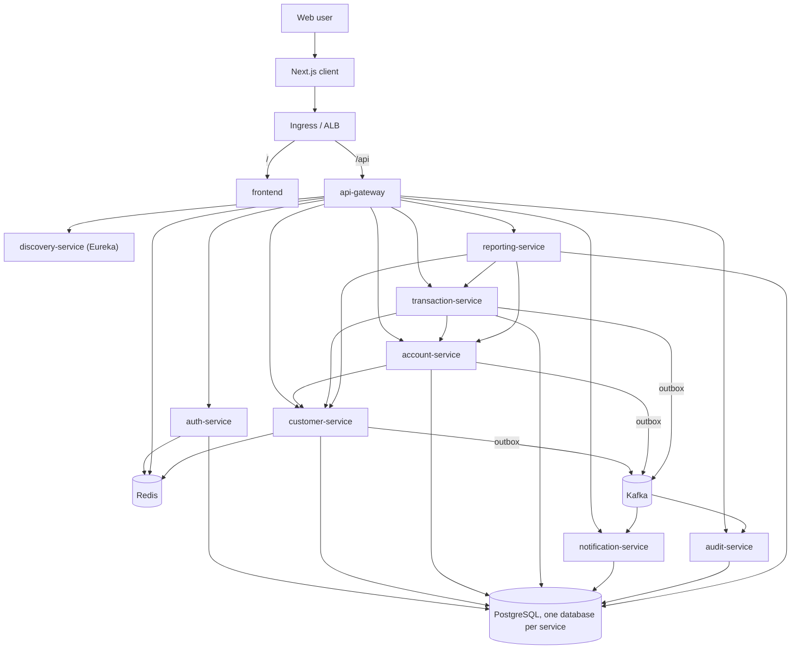

# Loretta Bank

Loretta Bank is a digital banking platform built as event-driven microservices.
It has nine Spring Boot 3.4 services on Java 21 and a Next.js web client.
Domain events flow through Kafka using the transactional outbox pattern, and
each service owns its own PostgreSQL database. The system runs locally with
Docker Compose and deploys to AWS EKS with Helm and Terraform.

> **Project status: active development.** The infrastructure and service
> skeleton are in place. The banking product on top is still being completed:
> correct double-entry accounting, onboarding, payments to other people, cards,
> and a back office. See [Known limitations](#known-limitations) and
> [Roadmap](#roadmap) before relying on any behaviour.

## Contents

- [Screenshots](#screenshots)
- [Architecture](#architecture)
- [Services](#services)
- [Tech stack](#tech-stack)
- [Quick start](#quick-start)
- [Using the API](#using-the-api)
- [Roles](#roles)
- [Testing](#testing)
- [Deployment](#deployment)
- [Design decisions](#design-decisions)
- [Known limitations](#known-limitations)
- [Roadmap](#roadmap)
- [License](#license)

## Screenshots


The screenshot shows the **target design** of the web client. These screens
are built today: sign-in, registration, dashboard, accounts, account detail,
transfers, transaction history, and the admin panel. The cards, statements,
profile, and settings screens are designed but not yet built.

## Architecture



How a request flows:

1. The browser calls the **api-gateway**.
2. The gateway validates the JWT, checks the revocation list in Redis, applies per-user rate limiting, and forwards `X-User-Id`, `X-User-Email`, and `X-User-Roles` headers to the target service.
3. Services enforce role and ownership rules using those headers.
4. Writes that other services care about are stored in an `outbox_events` table in the same database transaction as the change. A scheduled publisher sends them to Kafka.
5. The audit and notification services consume those events.

## Services

| Service | Port | Responsibility |
|---------|------|----------------|
| `discovery-service` | 8761 | Eureka service registry |
| `api-gateway` | 8080 | Single entry point: JWT validation, revocation check, Redis rate limiting, CORS, correlation IDs |
| `auth-service` | 8081 | Registration, login, access and refresh tokens, logout (token revocation), admin user and role management |
| `customer-service` | 8082 | Customer profiles and KYC status, with Redis caching |
| `account-service` | 8083 | Accounts (checking and savings), balances, freeze and close |
| `transaction-service` | 8084 | Deposits, withdrawals, transfers (orchestrated saga with compensation), ledger entries |
| `notification-service` | 8085 | Consumes domain events and records notifications. Email and SMS delivery are stubs. |
| `audit-service` | 8086 | Append-only audit log of every domain event, deduplicated by event ID, with search for ADMIN and SUPPORT |
| `reporting-service` | 8087 | Account statements for a period |
| `frontend` | 3000 | Next.js 14 web client |

`server/shared` is a library used by every service. It holds the security
filter, domain event types, exception handling, and DTOs.

## Tech stack

| Area | Technologies |
|------|--------------|
| Backend | Java 21, Spring Boot 3.4, Spring Cloud Gateway, Eureka, Spring Security, Spring Data JPA, Flyway, MapStruct, Lombok, SpringDoc OpenAPI, Micrometer and Prometheus |
| Messaging and data | PostgreSQL 16 (database per service), Apache Kafka (KRaft), Redis 7 |
| Frontend | Next.js 14 (App Router), TypeScript, Tailwind CSS, TanStack Query, Zustand, Zod, Axios |
| Quality | JUnit 5, Testcontainers, Spotless (google-java-format, AOSP), Checkstyle, ESLint, Prettier |
| Delivery | Docker Compose, Helm umbrella chart, Terraform (AWS EKS, RDS, ElastiCache, MSK, ECR), GitHub Actions |

## Quick start

### Prerequisites

- Docker with Compose v2 and at least 8 GB of memory allocated
- For running services outside Docker: Java 21, Maven 3.9+, and Node.js 20+

### Run everything with Docker Compose

```bash
cp .env.example .env
docker compose up --build
```

The first build takes several minutes. `auth-service` has a long start period,
and the gateway waits for it.

| What | URL |
|------|-----|
| Web client | http://localhost:3000 |
| API gateway | http://localhost:8080 |
| Eureka dashboard | http://localhost:8761 |
| Swagger UI (per service) | `http://localhost:<port>/swagger-ui.html` |

On first boot, `auth-service` creates a local admin account:
`admin@lorettabank.co.za` / `AdminPass123!`. Change this outside local
development. See [Known limitations](#known-limitations).

### Run services from source

```bash
docker compose up postgres kafka redis        # infrastructure only
cd server && mvn clean install -DskipTests    # build all modules
cd discovery-service && mvn spring-boot:run   # then start each service
```

In this mode, Postgres is on host port `5433` and Redis is on `6380`. Point
`DB_URL` and `REDIS_HOST`/`REDIS_PORT` at those ports, or use the defaults in
each service's `application.yml`.

For the client:

```bash
cd client
cp .env.example .env.local    # NEXT_PUBLIC_API_URL=http://localhost:8080
npm install
npm run dev
```

## Using the API

All requests go through the gateway. Requests in `server/http/*.http` can be
run from IntelliJ or VS Code (REST Client).

```bash
# Register and log in
curl -s -X POST http://localhost:8080/api/v1/auth/register \
  -H "Content-Type: application/json" \
  -d '{"email":"john@lorettabank.co.za","password":"SecurePass123!","firstName":"John","lastName":"Doe"}'

curl -s -X POST http://localhost:8080/api/v1/auth/login \
  -H "Content-Type: application/json" \
  -d '{"email":"john@lorettabank.co.za","password":"SecurePass123!"}'

export TOKEN="<accessToken from the login response>"

# Create the customer profile (userId comes from the login response)
curl -s -X POST http://localhost:8080/api/v1/customers \
  -H "Authorization: Bearer $TOKEN" -H "Content-Type: application/json" \
  -d '{"userId":2,"firstName":"John","lastName":"Doe","email":"john@lorettabank.co.za","phoneNumber":"+27821234567","idNumber":"9501015800089","dateOfBirth":"1995-01-01","address":"123 Main Street, Cape Town, 8001"}'

# Open an account (customerId comes from the previous response)
curl -s -X POST http://localhost:8080/api/v1/accounts \
  -H "Authorization: Bearer $TOKEN" -H "Content-Type: application/json" \
  -d '{"customerId":1,"accountType":"CHECKING","currency":"ZAR"}'

# Transfer between two of your accounts (requires an Idempotency-Key)
curl -s -X POST http://localhost:8080/api/v1/transfers \
  -H "Authorization: Bearer $TOKEN" -H "Content-Type: application/json" \
  -H "Idempotency-Key: xfer-$(uuidgen)" \
  -d '{"sourceAccountId":1,"targetAccountId":2,"amount":200.00,"currency":"ZAR","description":"Savings"}'

# History and statements
curl -s "http://localhost:8080/api/v1/transactions/account/1?page=0&size=20" -H "Authorization: Bearer $TOKEN"
curl -s -X POST http://localhost:8080/api/v1/reports/statements \
  -H "Authorization: Bearer $TOKEN" -H "Content-Type: application/json" \
  -d '{"accountId":1,"periodFrom":"2026-01-01T00:00:00","periodTo":"2026-12-31T23:59:59"}'
```

### Endpoint overview

| Area | Endpoints |
|------|-----------|
| Auth | `POST /api/v1/auth/{register,login,refresh,logout}`, `GET /api/v1/auth/users[/{id}]`, `PUT /api/v1/auth/users/{id}/role` |
| Customers | `POST /api/v1/customers`, `GET /api/v1/customers/{id}`, `GET /api/v1/customers/me`, `PUT /api/v1/customers/{id}`, `PATCH /api/v1/customers/{id}/kyc`, `GET /api/v1/customers` |
| Accounts | `POST /api/v1/accounts`, `GET /api/v1/accounts/{id}`, `GET /api/v1/accounts/customer/{customerId}`, `POST /api/v1/accounts/{id}/{deposit,withdraw}`, `PATCH /api/v1/accounts/{id}/{freeze,close}` |
| Transactions | `POST /api/v1/transactions/{deposit,withdraw}`, `GET /api/v1/transactions/{id}`, `GET /api/v1/transactions/account/{id}[/ledger]` |
| Transfers | `POST /api/v1/transfers`, `GET /api/v1/transfers/{id}` |
| Notifications | `GET /api/v1/notifications[/{id}]` |
| Audit | `GET /api/v1/audit`, `GET /api/v1/audit/{id}`, `GET /api/v1/audit/aggregate/{type}/{id}` |
| Reports | `POST /api/v1/reports/statements`, `GET /api/v1/reports/statements/{id}`, `GET /api/v1/reports/statements/{account,customer}/{id}` |

## Roles

| Role | Access |
|------|--------|
| `CUSTOMER` | Their own profile, accounts, transactions, transfers, and statements |
| `SUPPORT` | Read-only access to customers, accounts, transactions, and audit logs |
| `ADMIN` | Everything, including user roles, KYC status, and freezing or closing accounts |

## Testing

```bash
cd server
mvn test               # unit tests
mvn verify             # unit + integration tests (Testcontainers; needs Docker)
mvn spotless:check     # formatting (mvn spotless:apply to fix)
mvn checkstyle:check   # static analysis

cd ../client
npm run lint
npm run typecheck
```

Coverage is currently thin. The integration tests cover auth security, account
security, account persistence, and transaction persistence.

## Deployment

### Environments

| Environment | Infrastructure | Trigger |
|-------------|----------------|---------|
| Local | Docker Compose (Postgres, Kafka, and Redis in containers) | `docker compose up` |
| Staging | EKS, with infrastructure in-cluster through Helm | Push to `main` |
| Production | EKS with managed AWS services (RDS, ElastiCache, MSK) | Manual `workflow_dispatch` |

### Helm

`helm/loretta-bank` is an umbrella chart with 14 subcharts: one per service,
the frontend (with ingress), shared config and secrets, and optional in-cluster
Postgres, Redis, and Kafka.

- `global.*` values (database host, Kafka brokers, Redis host, JVM options) flow down to every subchart.
- `postgres.enabled`, `redis.enabled`, and `kafka.enabled` are `true` in `values.yaml` and `false` in `values-production.yaml`, where services point at managed AWS endpoints.
- With `global.externalSecrets.enabled: true`, secrets come from AWS Secrets Manager through `ExternalSecret` resources.

```bash
helm lint helm/loretta-bank
helm upgrade --install loretta-bank ./helm/loretta-bank \
  --namespace loretta-bank --create-namespace                        # staging
helm upgrade --install loretta-bank ./helm/loretta-bank \
  --namespace loretta-bank --create-namespace \
  --values helm/loretta-bank/values-production.yaml                  # production
```

### CI/CD

- **CI** (`.github/workflows/ci.yml`, on pull requests): Spotless, Checkstyle, `mvn verify` against Postgres and Redis service containers, Helm lint, and Docker builds for all 10 images.
- **CD** (`.github/workflows/cd.yml`): a push to `main` deploys every service to staging. A manual dispatch picks the environment and toggles a per-service flag, so you can, for example, ship only `auth-service` and `api-gateway` to production.

### Terraform

- `terraform/aws-eks-production`: a VPC across 3 AZs, EKS (Graviton nodes, 2–6 autoscaling), Multi-AZ RDS PostgreSQL 16, ElastiCache Redis with failover, MSK Kafka (KRaft, 3 brokers), ECR repositories, the AWS Load Balancer Controller, and External Secrets through IRSA.
- `terraform/aws-eks-cheap`: a cost-optimized Spot cluster for experiments.

```bash
cd terraform/aws-eks-production
cp terraform.tfvars.example terraform.tfvars
terraform init && terraform plan
```

## Design decisions

1. **Transactional outbox.** Events are written in the same transaction as the state change and published asynchronously. This avoids dual-write inconsistency between the database and Kafka.
2. **Orchestrated saga for transfers.** `transaction-service` drives debit → credit, with a compensating credit if the second step fails. Transfers require an `Idempotency-Key`.
3. **Gateway-terminated authentication.** The gateway validates JWTs and forwards identity headers; services apply role and ownership checks.
4. **Exact money.** All amounts are `NUMERIC(19,4)` and `BigDecimal`. The currency defaults to ZAR.
5. **Database per service.** Each service owns its schema and Flyway migrations.
6. **Selective deploys.** The CD pipeline can roll out individual services through dispatch flags.

## Known limitations

These are tracked and are being fixed as a priority:

- **Balances and the ledger can diverge.** Account balances live in `account-service`, ledger entries in `transaction-service`, and some paths update one without the other. Deposits are single-entry, and balance updates have no concurrency control.
- **Customers can deposit arbitrary amounts.** There is no modelled funding source yet.
- **Transfers are not crash-safe.** The saga runs inside the HTTP request, with no recovery for a transfer interrupted between debit and credit.
- **Service-to-service trust is header-based.** Services trust identity headers, and Docker Compose publishes every service port. Run the stack only on a trusted machine.
- **Some read endpoints lack ownership checks** (for example, transfer lookup by ID).
- **Notifications are recorded but not delivered.** Most of them are not linked to a user.
- **Statements for past periods** compute the opening balance from the current balance, so they can be wrong.
- **KYC status is not enforced** on account opening or payments.
- **Client sessions.** The access token is stored in a JavaScript-readable cookie, refresh tokens are not used, and sign-out does not revoke tokens.
- **Default secrets.** A development JWT secret and a bootstrap admin password ship in configuration.
- **The product is incomplete.** There is no self-service onboarding flow, no payments to other people, no beneficiaries, no cards, no statements UI, and no profile or settings screens.

## Roadmap

1. **Security and integrity fixes.** Remove self-deposit, close ownership gaps, fail closed on token revocation, restrict network exposure, remove default secrets, and add optimistic locking.
2. **A trustworthy ledger.** A single owner for balances, true double-entry postings with system accounts, holds, end-to-end idempotency, durable transfer recovery, a single event per money movement, nightly reconciliation, and correct statements.
3. **A complete customer product.** Onboarding with KYC, MFA and step-up auth, beneficiaries and payments to anyone, scheduled payments and limits, virtual cards, server-side transaction search, statement PDFs, a notifications inbox, and profile and settings.
4. **A real back office.** A KYC review queue, customer 360, account actions with reasons, user management, an audit viewer, and an exceptions queue for failed transfers.
5. **Platform hardening.** Signed internal service tokens and mTLS, RS256 with JWKS, refresh rotation and HttpOnly cookies, Resilience4j, Kafka DLQs, OpenTelemetry tracing and dashboards, and a broader test suite (property-based ledger tests, contract tests, Playwright end-to-end tests, load tests).
6. **Intelligent features.** A Python AI service for:
   - transaction categorization and spending insights
   - natural-language transaction search
   - a help-centre assistant with cited answers
   - a banking assistant that can only *propose* actions for the customer to confirm
   - a support copilot
   - fraud detection
   - voice banking

   All of these are built on Claude and OpenAI models, with evaluation suites, tracing, and cost controls.

## License

MIT. See [LICENSE](LICENSE).
